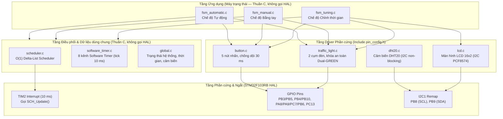
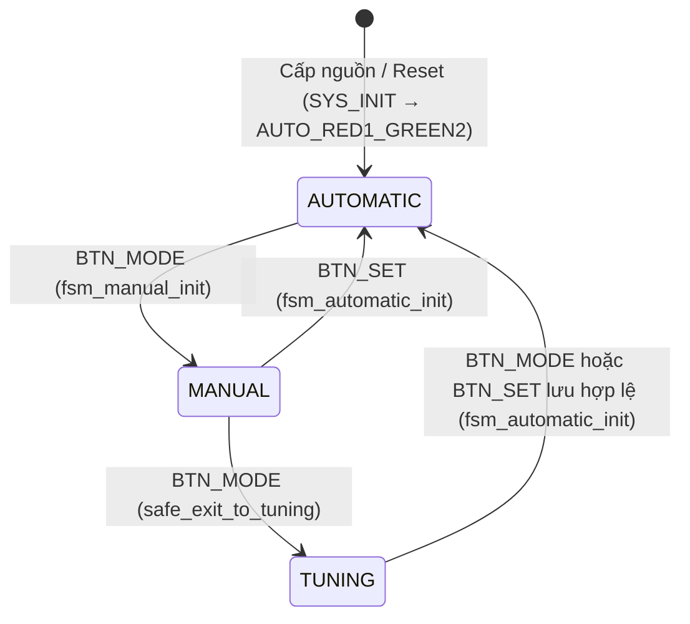
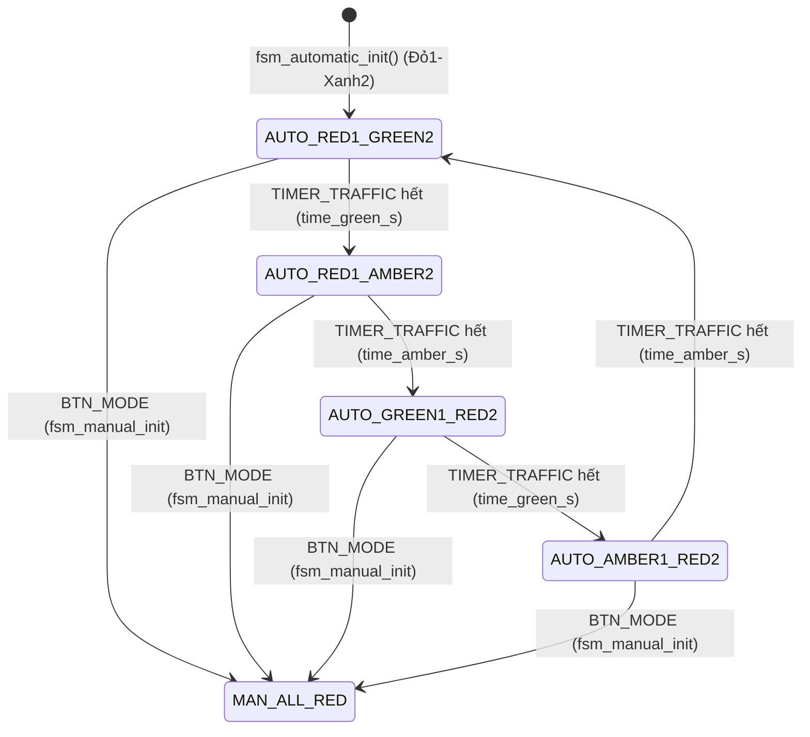
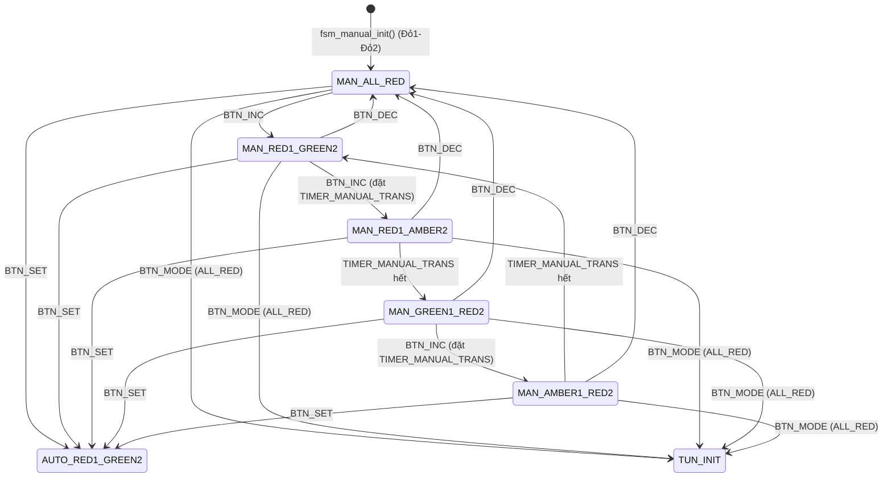

# BÁO CÁO BÀI TẬP LỚN
**MÔN: VI XỬ LÝ – VI ĐIỀU KHIỂN (CO3009)**  
*ĐẠI HỌC QUỐC GIA TP. HỒ CHÍ MINH — TRƯỜNG ĐẠI HỌC BÁCH KHOA — KHOA KHOA HỌC VÀ KỸ THUẬT MÁY TÍNH*

---

## ĐỀ TÀI
**HỆ THỐNG ĐÈN GIAO THÔNG 2 TUYẾN ĐƯỜNG TRÊN MẠCH XNUCLEO-F103RB**

- **Giảng viên hướng dẫn:** TS. Nguyễn Hòa Hưng
- **Lớp:** `[L0x]`
- **Nhóm:** `[XX]`

### THÀNH VIÊN NHÓM

| STT | Họ và tên | MSSV | Nhóm | Nhiệm vụ phụ trách | Đóng góp |
|---|---|---|---|---|---|
| 1 | Phan Lê Anh Huy | 2411249 | `[XX]` | Kiến trúc phân lớp, cấu hình CubeIDE (`.ioc`), kiểm thử GPIO/LED/nút, `O(1)` Scheduler, `software_timer`, `button`, `traffic_light`, `global`, FSM Automatic & FSM Manual | 50% |
| 2 | `[Họ và tên Thành viên B]` | `[MSSV B]` | `[XX]` | Kiểm thử `I2C1` scan, driver `DHT20` (non-blocking), driver & menu `LCD`, FSM Tuning (`T_RED == T_GREEN + T_AMBER`), tích hợp `main.c`, kiểm thử tổng thể | 50% |

### MÃ NGUỒN DỰ ÁN

| Hạng mục | Thông tin |
|---|---|
| **Link GitHub dự án** | https://github.com/huy-creataor/BTL_VXL |
| **Nhánh / Tag nộp bài** | `[main / v1.0-final]` |
| **Commit hash cuối** | `[Điền 7 ký tự đầu sau khi merge main & gắn tag]` |

*TP. Hồ Chí Minh, tháng 12 năm 2026*

---

## 1. Giới thiệu dự án

### 1.1 Tổng quan
Bài toán đặt ra là thiết kế và hiện thực hệ thống điều khiển đèn giao thông tại ngã tư gồm **2 tuyến đường cắt nhau** chạy thời gian thực trên vi điều khiển **STM32F103RB** (kit **XNUCLEO-F103RB** kèm mạch mở rộng chuẩn **Grove**). Hệ thống sử dụng các ngoại vi gồm:
- **2 module đèn giao thông Grove** (mỗi module điều khiển 4 trạng thái `Tắt / Đỏ / Vàng / Xanh` qua 2 chân tín hiệu số).
- **2 module nút nhấn đôi Grove** (4 nút nhấn điều khiển chế độ và tham số) cùng **nút USER (`PC13`)** và **2 LED onboard (`PA5`, `PC9`)**.
- **Cảm biến nhiệt độ – độ ẩm `DHT20`** và **màn hình `LCD 16x2`** giao tiếp chung trên bus **`I2C1`** (`PB8`/`PB9`).

Mục tiêu của dự án là xây dựng phần mềm nhúng theo **kiến trúc phân lớp tách biệt phần cứng/phần mềm**, vận hành hoàn toàn bằng **bộ lập lịch hợp tác `O(1)` (Cooperative Scheduler)** kết hợp **Software Timer** ở nhịp `10 ms` (không dùng `HAL_Delay()` trong chương trình chính), đảm bảo chuyển pha an toàn tuyệt đối (không bao giờ xảy ra trạng thái hai tuyến cùng đèn Xanh).

| `[Chèn ảnh chụp hệ thống phần cứng hoàn chỉnh của nhóm trên mạch XNUCLEO-F103RB]` |
|---|

*Hình 1.1: Hệ thống phần cứng hoàn chỉnh*

### 1.2 Các chức năng của hệ thống

| STT | Chức năng | Mô tả | Thao tác / Nút nhấn |
|---|---|---|---|
| 1 | **Chế độ tự động (`AUTO`)** | Hai tuyến luân phiên chạy chu trình `Đỏ1–Xanh2` → `Đỏ1–Vàng2` → `Xanh1–Đỏ2` → `Vàng1–Đỏ2` theo thời gian `time_red_s`, `time_green_s`, `time_amber_s`; đếm ngược từng giây và hiển thị lên LCD. | Tự động chạy khi khởi động; nhấn `BTN_1` (`D7/PA8`) để chuyển sang Bằng tay. |
| 2 | **Chế độ bằng tay (`MANUAL`)** | Cho phép người vận hành chủ động đổi pha Xanh giữa 2 tuyến hoặc đưa về trạng thái dừng khẩn cấp 2 tuyến cùng Đỏ; mọi lần đổi pha Xanh đều bắt buộc qua pha đệm Vàng an toàn. | `BTN_2` (`D8`): đổi pha; `BTN_3` (`D9`): dừng `ALL_RED`; `BTN_4` (`D10`): về `AUTO`; `BTN_1` (`D7`): sang `TUNING`. |
| 3 | **Chế độ chỉnh thời gian (`TUNING`)** | Cho phép chỉnh thời gian Đỏ, Xanh, Vàng trong biên `[1..99]` giây với đèn tương ứng nhấp nháy; kiểm tra ràng buộc `T_RED == T_GREEN + T_AMBER` trước khi lưu. | `BTN_2` (`D8`): `+1s`; `BTN_3` (`D9`): `-1s`; `BTN_4` (`D10`): xác nhận/chuyển màu; `BTN_1` (`D7`): thoát sang `AUTO`. |
| 4 | **Hiển thị nhiệt độ, độ ẩm** | Đọc cảm biến `DHT20` qua `I2C1` theo cơ chế non-blocking (task chạy mỗi `50 ms`, chờ đo `100 ms`, làm mới số đo định kỳ ~2 s) và hiển thị lên `LCD 16x2` kèm trạng thái đèn. | Tự động cập nhật định kỳ qua scheduler. |
| 5 | **Khôi phục thời gian mặc định** | Đặt lại bộ thời gian Đỏ – Xanh – Vàng về giá trị chuẩn `(5s – 3s – 2s)` và khởi tạo lại chu kỳ tự động an toàn. | Nhấn nút `BTN_USER` (`PC13` trên mạch Nucleo) khi đang ở chế độ `AUTO`. |

### 1.3 Sơ đồ khối hệ thống



*Hình 1.2: Sơ đồ khối kiến trúc phân lớp của hệ thống*

---

## 2. Thiết kế dự án

### 2.1 Tổng quan các chế độ hoạt động

Ngay sau khi cấp nguồn hoặc nhấn Reset, `global_init()` khởi tạo `status = SYS_INIT` cùng bộ thời gian mặc định **`time_red_s = 5`**, **`time_green_s = 3`**, **`time_amber_s = 2`**. Ở lần chạy đầu tiên của `fsm_automatic_run()`, hệ thống chuyển từ `SYS_INIT` vào `fsm_automatic_init()`, xóa toàn bộ timer/cờ nút cũ và bắt đầu tại trạng thái an toàn **`AUTO_RED1_GREEN2`** (Tuyến 1 **Đỏ**, Tuyến 2 **Xanh**).

Bảng chức năng thống nhất cho 5 nút nhấn trên cả 3 chế độ (khai báo tại `Core/Inc/button.h`):

| Nút nhấn | Chế độ Tự động (`AUTO`) | Chế độ Bằng tay (`MANUAL`) | Chế độ Chỉnh thời gian (`TUNING`) |
|---|---|---|---|
| **Nút 1 (`D7` / `PA8` — `BTN_MODE`)** | Chuyển sang chế độ **Bằng tay** (`MAN_ALL_RED`). | Chuyển sang chế độ **Chỉnh thời gian** (`TUN_INIT`). | Thoát về chế độ **Tự động** (hủy thay đổi chưa hợp lệ hoặc quay lại chu kỳ an toàn). |
| **Nút 2 (`D8` / `PA9` — `BTN_INC`)** | Không tác dụng. | Chuyển pha đèn (`ALL_RED` → `RED1_GREEN2`, hoặc qua pha đệm **Vàng** để đảo sang tuyến đối diện). | Tăng giá trị thời gian đang chọn `+1s` (hỗ trợ nhấn giữ tự tăng mỗi `250 ms`). |
| **Nút 3 (`D9` / `PC7` — `BTN_DEC`)** | Không tác dụng. | Dừng khẩn cấp ngay về trạng thái **`MAN_ALL_RED`** (cả 2 tuyến Đỏ). | Giảm giá trị thời gian đang chọn `-1s` (hỗ trợ nhấn giữ tự giảm mỗi `250 ms`). |
| **Nút 4 (`D10` / `PB6` — `BTN_SET`)** | Không tác dụng. | Quay về chế độ **Tự động** (`fsm_automatic_init()`). | Xác nhận giá trị & chuyển mục chỉnh (`Đỏ → Xanh → Vàng → Kiểm tra & Lưu`). |
| **Nút USER (`PC13` — `BTN_USER_IDX`)** | Khôi phục thời gian mặc định `(5s, 3s, 2s)` và khởi tạo lại `AUTO_RED1_GREEN2`. | Không tác dụng. | `[Tùy chọn: khôi phục giá trị tạm về mặc định]` |

### 2.2 Máy trạng thái chuyển chế độ



*Hình 2.1: Máy trạng thái chuyển đổi giữa các chế độ lớn*

| Chế độ hiện tại | Sự kiện | Chế độ kế tiếp | Hành động khi chuyển |
|---|---|---|---|
| `AUTOMATIC` | Nhấn `BTN_MODE` (`D7`) | `MANUAL` | Xóa `TIMER_TRAFFIC`, `TIMER_COUNTDOWN`, gọi `fsm_manual_init()` đưa 2 tuyến về `ALL_RED` (`MAN_ALL_RED`). |
| `MANUAL` | Nhấn `BTN_MODE` (`D7`) | `TUNING` | Gọi `safe_exit_to_tuning()`: xóa toàn bộ timer & cờ nút, đặt 2 tuyến `ALL_RED`, đặt `status = TUN_INIT`. |
| `MANUAL` | Nhấn `BTN_SET` (`D10`) | `AUTOMATIC` | Xóa `TIMER_MANUAL_TRANS`, gọi `fsm_automatic_init()` bắt đầu từ `AUTO_RED1_GREEN2`. |
| `TUNING` | Nhấn `BTN_MODE` hoặc lưu xong bằng `BTN_SET` | `AUTOMATIC` | Hủy chỉnh sửa chưa hợp lệ (nếu dùng `BTN_MODE`) hoặc kiểm tra `T_RED == T_GREEN + T_AMBER` rồi nạp thông số mới, gọi `fsm_automatic_init()`. |

### 2.3 Phân tích chuyển đổi giữa các chế độ lớn

#### 2.3.1 Từ chế độ tự động sang chế độ bằng tay
Khi người dùng nhấn `BTN_MODE` ở **bất kỳ pha nào** trong `fsm_automatic_run()` (kể cả đúng lúc đang đèn Xanh hay đang đèn Vàng `AUTO_RED1_AMBER2` / `AUTO_AMBER1_RED2`):
1. **Trạng thái đèn ngay sau khi chuyển**: `fsm_manual_init()` gọi `enter_manual_all_red()` → `traffic_all_red()`, lập tức đưa **cả 2 tuyến về ĐỎ** (`MAN_ALL_RED`).
2. **Software timer & task trong scheduler**: Xóa toàn bộ `TIMER_TRAFFIC`, `TIMER_COUNTDOWN`, `TIMER_BLINK`, `TIMER_MANUAL_TRANS` bằng `clearTimer()` và xóa các cờ nút nhấn còn tồn bằng `button_clear_all()`. Các task định kỳ trên scheduler vẫn giữ nguyên hoạt động bình thường; chỉ nhánh xử lý theo biến `status` chuyển từ `fsm_automatic_run` sang `fsm_manual_run`.
3. **Biến đếm thời gian**: `countdown_lane1 = 0`, `countdown_lane2 = 0` (chế độ bằng tay không đếm ngược pha tự động).
4. **Hiển thị trên LCD**: Task LCD đọc `status == MAN_ALL_RED`, chuyển từ màn hình đếm ngược `AUTO` sang màn hình `MANUAL` hiển thị trạng thái `ALL RED` cùng nhiệt độ/độ ẩm DHT20.
5. **Đảm bảo an toàn (không bao giờ 2 tuyến cùng Xanh)**: Dù đang ở `GREEN` của tuyến nào khi bấm chuyển chế độ, đèn đều được đưa tức thời về trạng thái tĩnh `ALL_RED`, hoàn toàn loại bỏ rủi ro giữ nhầm pha Xanh cũ hoặc đếm sót timer từ chế độ `AUTO`.

#### 2.3.2 Từ chế độ bằng tay sang chế độ chỉnh thời gian
Khi người dùng nhấn `BTN_MODE` trong `fsm_manual_run()` (kể cả khi đang ở giữa pha đệm Vàng `MAN_RED1_AMBER2` hoặc `MAN_AMBER1_RED2`):
1. **Trạng thái đèn ngay sau khi chuyển**: `safe_exit_to_tuning()` gọi `traffic_all_red()` đưa cả 2 tuyến về **ĐỎ** ngay lập tức trước khi chuyển sang `TUN_INIT`. Sau đó `fsm_tuning_init()` sẽ điều khiển nhấp nháy cụm đèn tương ứng mục đang chỉnh.
2. **Software timer & task trong scheduler**: Xóa sạch cả 4 kênh timer (`TIMER_TRAFFIC`, `TIMER_COUNTDOWN`, `TIMER_BLINK`, `TIMER_MANUAL_TRANS`) — đặc biệt đảm bảo `TIMER_MANUAL_TRANS` nếu đang đếm dở sẽ bị hủy hoàn toàn; đồng thời gọi `button_clear_all()`.
3. **Biến đếm thời gian**: Đặt `countdown_lane1 = 0`, `countdown_lane2 = 0`; `fsm_tuning_init()` sao chép `time_red_s`, `time_green_s`, `time_amber_s` sang bộ biến tạm `temp_time_*_s` để chỉnh sửa độc lập mà chưa ảnh hưởng cấu hình đang chạy.
4. **Hiển thị trên LCD**: Màn hình LCD chuyển sang giao diện `TUNING` (hiển thị màu đèn đang chỉnh, giá trị tạm `temp_time_*_s` và tổng quan 3 giá trị Đỏ/Xanh/Vàng).
5. **Đảm bảo an toàn**: Vì thoát qua `ALL_RED` và xóa hết timer chuyển pha trước khi vào `TUN_INIT`, không có tình huống đèn Xanh còn sót lại khi người dùng đang thao tác chỉnh tham số.

*(Trường hợp người dùng nhấn `BTN_SET` từ `MANUAL` để quay thẳng về `AUTOMATIC`: hệ thống xóa `TIMER_MANUAL_TRANS` và gọi `fsm_automatic_init()`, đưa đèn về `AUTO_RED1_GREEN2` với bộ đếm thời gian được khởi tạo mới hoàn toàn.)*

#### 2.3.3 Từ chế độ chỉnh thời gian về chế độ tự động
1. **Kiểm tra tính hợp lệ của thời gian mới**: Trước khi ghi bộ giá trị tạm (`temp_time_red_s`, `temp_time_green_s`, `temp_time_amber_s`) vào biến chính thức, `fsm_tuning_validate()` kiểm tra đồng thời 2 điều kiện:
   - Mỗi giá trị nằm trong miền cho phép `[MIN_LIGHT_TIME_S, MAX_LIGHT_TIME_S]` (`1..99` giây).
   - **Ràng buộc đồng bộ 2 tuyến:** `temp_time_red_s == temp_time_green_s + temp_time_amber_s`.
   - Nếu **không hợp lệ**, hệ thống giữ nguyên thời gian cũ (`time_*_s`) và hiển thị cảnh báo lỗi qua `lcd_display_error()` (hoặc tự động khôi phục khi nhấn `BTN_MODE` thoát); đồng thời `auto_sanitize_timings()` trong `fsm_automatic.c` cũng kiểm tra lại lần nữa để bảo vệ phòng ngừa.
2. **Trạng thái đèn & biến đếm khi về `AUTO`**: `fsm_automatic_init()` xóa `TIMER_BLINK` / `TIMER_LCD`, xóa cờ nút, đưa hệ thống về `AUTO_RED1_GREEN2` (`Đỏ 1 – Xanh 2`), nạp `countdown_lane1 = time_red_s`, `countdown_lane2 = time_green_s`, `TIMER_TRAFFIC = SEC_TO_MS(time_green_s)` và `TIMER_COUNTDOWN = 1000 ms`.
3. **Hiển thị LCD & Đảm bảo an toàn**: LCD quay về màn hình `AUTO` với số giây đếm ngược mới; nhờ ràng buộc `T_RED == T_GREEN + T_AMBER`, tuyến Đỏ luôn giữ Đỏ trọn vẹn trong suốt pha Xanh và pha Vàng của tuyến còn lại, không bao giờ xảy ra 2 tuyến cùng Xanh. *(Thành viên B bổ sung chi tiết luồng nhấn `BTN_SET` / `BTN_MODE` cụ thể trong `fsm_tuning.c`).*

---

## 3. Hiện thực dự án

### 3.1 Kết nối phần cứng

Đối chiếu schematic mạch **XNUCLEO-F103RB** (`STM32F103RBTx`), dự án cấu hình bắt buộc **`SYS → Debug = Serial Wire`** để vừa không bị khóa SWD sau lần nạp đầu, vừa giải phóng chân `PB3` (`JTDO`) và `PB4` (`NJTRST`) làm GPIO điều khiển đèn. Do chân `D10` nối với `PB6` (dùng cho `BTN_4`), ngoại vi **`I2C1` bắt buộc remap sang `PB8` (`I2C1_SCL`) và `PB9` (`I2C1_SDA`)**.

| Thiết bị | Chân Arduino | Chân STM32 | Chế độ GPIO | Tên (User Label) |
|---|---|---|---|---|
| Đèn giao thông 1 (`A`) | `D3` | `PB3` | `GPIO_Output` (Push-Pull) | `TL1_A` |
| Đèn giao thông 1 (`B`) | `D4` | `PB5` | `GPIO_Output` (Push-Pull) | `TL1_B` |
| Đèn giao thông 2 (`A`) | `D5` | `PB4` | `GPIO_Output` (Push-Pull) | `TL2_A` |
| Đèn giao thông 2 (`B`) | `D6` | `PB10` | `GPIO_Output` (Push-Pull) | `TL2_B` |
| Nút nhấn 1 (`BTN_MODE`) | `D7` | `PA8` | `GPIO_Input` (No-pull / Pull theo mạch) | `BTN_1` |
| Nút nhấn 2 (`BTN_INC`) | `D8` | `PA9` | `GPIO_Input` | `BTN_2` |
| Nút nhấn 3 (`BTN_DEC`) | `D9` | `PC7` | `GPIO_Input` | `BTN_3` |
| Nút nhấn 4 (`BTN_SET`) | `D10` | `PB6` | `GPIO_Input` | `BTN_4` |
| LED onboard 1, 2 | `D13` / – | `PA5`, `PC9` | `GPIO_Output` (Push-Pull) | `LED_USER1`, `LED_USER2` |
| Nút USER onboard | – | `PC13` | `GPIO_Input` | `BTN_USER` |
| DHT20, LCD (`I2C1`) | Khe I2C đỏ (`D15`/`D14`) | `PB8` (`SCL`), `PB9` (`SDA`) | `I2C` (Standard 100 kHz) | Địa chỉ: `0x38` (DHT20), `[0x27/0x3F]` (LCD) |

**Bảng kiểm thử tổ hợp 2 tín hiệu điều khiển module đèn (Bước 3.2):**  
*(Lưu ý: Xác nhận lại trên phần cứng thật bằng vòng lặp 4 tổ hợp `(0,0) -> (1,1)` và cập nhật các macro `TL_SIG_*` trong `Core/Inc/pin_config.h` nếu module thực tế khác chiều bit mặc định.)*

| Tín hiệu `A` (`TLx_A`) | Tín hiệu `B` (`TLx_B`) | Trạng thái đèn mặc định (`pin_config.h`) | Kết quả đo thực tế trên mạch |
|---|---|---|---|
| `0` | `0` | `OFF` (Tắt) | `[Điền kết quả quan sát Bước 3.2]` |
| `0` | `1` | `AMBER` (Vàng) | `[Điền kết quả quan sát Bước 3.2]` |
| `1` | `0` | `RED` (Đỏ) | `[Điền kết quả quan sát Bước 3.2]` |
| `1` | `1` | `GREEN` (Xanh) | `[Điền kết quả quan sát Bước 3.2]` |

- **Mức logic nút nhấn đo thực tế (Bước 3.3):** Nút Grove `BTN_1..BTN_4`: `[GPIO_PIN_RESET / GPIO_PIN_SET]`; nút `BTN_USER` (`PC13`): `GPIO_PIN_RESET`.

```c
/* Trích đoạn cấu hình GPIO (main.c – MX_GPIO_Init, dán từ STM32CubeIDE sau khi Generate Code) */
static void MX_GPIO_Init(void) {
    /* TODO: Dán hàm MX_GPIO_Init() sinh từ file .ioc của nhóm */
}
```

### 3.2 Hiện thực scheduler

#### 3.2.1 Lựa chọn cấu trúc dữ liệu
Nhóm lựa chọn **mảng tĩnh sắp xếp theo độ trễ tương đối (Sorted Delta List)** với kích thước cố định `SCH_MAX_TASKS = 40U` và `NO_TASK_ID = 0U` thay vì dùng Danh sách liên kết (Linked List) cấp phát động vì:
- **Không dùng `malloc`/`free`**: Vi điều khiển `STM32F103RB` chỉ có 20 KB SRAM; mảng tĩnh loại bỏ hoàn toàn nguy cơ phân mảnh bộ nhớ và rò rỉ vùng nhớ khi chạy dài hạn.
- **Đạt độ phức tạp `O(1)` cho `SCH_Update()`**: Danh sách luôn được duy trì theo thứ tự thời điểm thực thi tăng dần, mỗi phần tử lưu `Delay` tương đối (hiệu số tick so với task đứng ngay trước nó). Do đó trong ngắt `TIM2`, `SCH_Update()` chỉ cần kiểm tra duy nhất phần tử đầu mảng `SCH_tasks_G[0]`.
- **Chi phí hợp lý**: Với tối đa 40 slot, thao tác dịch mảng được chuyển hoàn toàn ra ngoài ngắt (nằm trong `Insert()` và `SCH_Delete_Task()` ở ngữ cảnh `main`).

```c
/* Khai báo trong Core/Inc/scheduler.h */
#define SCH_MAX_TASKS           40U
#define SCH_TICK_PERIOD_MS      10U
#define NO_TASK_ID              0U
#define SCH_INVALID_TASK_ID     NO_TASK_ID

typedef struct {
    void (*pTask)(void);    /* Con trỏ hàm task */
    uint32_t Delay;         /* Độ trễ tương đối (ticks) so với task đứng trước */
    uint32_t Period;        /* Chu kỳ lặp (ticks); 0 = one-shot task */
    uint8_t RunMe;          /* Cờ báo sẵn sàng chạy (0/1) */
    uint32_t TaskID;        /* Định danh duy nhất (> 0) */
} sTask;

/* Khai báo cấu trúc dữ liệu trong Core/Src/scheduler.c */
static sTask SCH_tasks_G[SCH_MAX_TASKS];
static volatile uint32_t SCH_count = 0U;
static uint32_t SCH_next_task_id = 1U;
```

#### 3.2.2 Hiện thực các hàm

| Hàm | Độ phức tạp | Giải thích |
|---|---|---|
| `SCH_Init` | $O(N)$ | Xóa trắng toàn bộ mảng `SCH_tasks_G`, đặt `SCH_count = 0`, `SCH_next_task_id = 1` trong vùng găng `SCH_Lock()`/`SCH_Unlock()`. |
| `SCH_Add_Task` | $O(N)$ | Kiểm tra `pFunc != NULL` và mảng chưa đầy, cấp `TaskID` duy nhất (`Get_New_Task_ID()`), gọi `Insert()` chèn vào vị trí bảo toàn thứ tự FIFO (`<=`) và trừ bớt `Delay` của task kế sau. |
| `SCH_Delete_Task` | $O(N)$ | Tìm task theo `TaskID`, cộng dồn `Delay` của nó sang phần tử `i + 1` (kể cả khi `i == 0`, đồng thời cập nhật `RunMe` nếu tổng delay về `0`), rồi dịch trái mảng. |
| `SCH_Update` | **$O(1)$** | Chạy trong ISR `TIM2`. Chỉ xét `SCH_tasks_G[0]`: giảm `Delay` nếu `> 0` và bật `RunMe = 1` khi `Delay == 0`. Không vòng lặp, không reload `Period`. |
| `SCH_Dispatch_Tasks` | $O(1)$ kiểm tra đầu mảng + $O(N)$ chèn lại | Kiểm tra `SCH_tasks_G[0].RunMe == 1`, sao chép `sTask t`, **mở khóa ngắt** rồi gọi `t.pTask()` chạy đến khi hoàn tất. Sau đó gọi `SCH_Delete_Task(t.TaskID)`: nếu xóa thành công và `t.Period > 0` thì gọi `Insert()` nạp lại với `Delay = t.Period`; nếu là one-shot (`t.Period == 0`) hoặc task đã tự xóa chính nó bên trong `pTask()` thì không chèn lại. |

```c
/* Vùng găng an toàn lồng nhau trên Cortex-M (Core/Src/scheduler.c) */
static inline uint32_t SCH_Lock(void) {
    uint32_t primask;
    __asm__ volatile ("mrs %0, primask\n" "cpsid i\n" : "=r" (primask) :: "memory");
    return primask;
}
static inline void SCH_Unlock(uint32_t primask) {
    __asm__ volatile ("msr primask, %0\n" :: "r" (primask) : "memory");
}

void SCH_Update(void) {
    if (SCH_count == 0U) return;
    if (SCH_tasks_G[0].Delay > 0U) SCH_tasks_G[0].Delay--;
    if (SCH_tasks_G[0].Delay == 0U) SCH_tasks_G[0].RunMe = 1U;
}

void SCH_Dispatch_Tasks(void) {
    while (1) {
        uint32_t m = SCH_Lock();
        if (SCH_count == 0U || SCH_tasks_G[0].RunMe == 0U) {
            SCH_Unlock(m);
            break;
        }
        sTask t = SCH_tasks_G[0];
        SCH_Unlock(m);

        if (t.pTask != NULL) t.pTask();

        if (SCH_Delete_Task(t.TaskID) && t.Period > 0U) {
            (void)Insert(t.pTask, t.Period, t.Period, t.TaskID);
        }
    }
}
```

#### 3.2.3 Danh sách task trong hệ thống

Hệ thống sử dụng nhịp ngắt **`TIM2` = 10 ms** (`1 tick = 10 ms`). Tham số `TIM2` trong `.ioc` tính theo công thức:
$$T = \frac{(PSC + 1) \times (ARR + 1)}{f_{\text{TIM2}}} = 0.01\text{ s}\ (10\text{ ms})$$
Với `f_TIM2 = 64 MHz` (mặc định Nucleo-F103RB HSI+PLL): chọn `PSC = 6399`, `ARR = 99` (hoặc `PSC = 7199, ARR = 99` nếu `72 MHz`; `PSC = 7999, ARR = 9` nếu `8 MHz`), bật `auto-reload preload = Enable` và bật `TIM2 global interrupt` trong NVIC. Thời gian thực thi `SCH_Update()` trên phần cứng có thể đo kiểm chứng $O(1)$ qua bộ đếm chu kỳ `DWT->CYCCNT`.

| Task | Delay (ms) | Period (ms) | Mô tả |
|---|---|---|---|
| `timer_run` | `0` | `10` | Cập nhật 8 kênh software timer (đặt đầu tiên để cập nhật cờ trước các FSM) |
| `button_read` | `0` | `10` | Đọc & chống dội 3 mẫu (30 ms) cho 5 nút nhấn |
| `system_fsm_task` | `10` | `10` | Điều phối theo `status` gọi `fsm_automatic_run()`, `fsm_manual_run()` hoặc `fsm_tuning_run()` |
| `dht20_task` | `20` | `50` | Đọc cảm biến `DHT20` non-blocking qua `I2C1` (lệch pha `20 ms`, chờ đo `100 ms`, chu kỳ ~2 s) |
| `lcd_update_task` | `50` | `200` | Cập nhật nội dung màn hình `LCD 16x2` cho chế độ `AUTO` / `MANUAL` qua `I2C1` (lệch pha `50 ms` tránh dồn tải I2C) |
| `one_shot_test` *(minh họa)* | `3000` | `0` | Task chạy đúng 1 lần sau `3000 ms` rồi tự động bị xóa khỏi hàng đợi |

### 3.3 Hiện thực các module phụ trợ

#### 3.3.1 Software Timer
- Hiện thực tại `Core/Src/software_timer.c` với `TICK = 10 ms` (`SCH_TICK_PERIOD_MS`) và `MAX_TIMERS = 8` kênh độc lập (`TimerChannel_t` phân bổ 5 kênh: `TIMER_TRAFFIC`, `TIMER_COUNTDOWN`, `TIMER_BLINK`, `TIMER_LCD`, `TIMER_MANUAL_TRANS`).
- `setTimer(index, duration_ms)` nạp `counter = duration_ms / TICK` (nếu `0 < duration_ms < TICK` thì giữ tối thiểu `1` tick; nếu `duration_ms == 0` bật ngay `timer_flag[index] = 1`).
- `timer_run()` chạy mỗi `10 ms` như một task của scheduler, giảm các bộ đếm `> 0` và bật `timer_flag[i] = 1` khi chạm `0`. `isTimerExpired(index)` kiểm tra không phá hủy cờ; `clearTimer(index)` đưa cả counter và flag về `0` khi chuyển chế độ.

#### 3.3.2 Button
- Hiện thực tại `Core/Src/button.c` cho 5 nút (`BTN_MODE`, `BTN_INC`, `BTN_DEC`, `BTN_SET`, `BTN_USER_IDX`).
- **Chống dội (Debounce) 3 mẫu (`30 ms`)**: Mỗi `10 ms`, `button_read()` dịch mẫu vào 3 thanh ghi `key_reg2 <- key_reg1 <- key_reg0`. Trạng thái ổn định `key_stable[i]` chỉ đổi khi cả 3 lần đọc liên tiếp giống nhau (`key_reg0 == key_reg1 == key_reg2`).
- **Nhấn ngắn & Nhấn giữ**: Khi phát hiện cạnh chuyển `0 -> 1`, bật `press_flag[i] = 1` (hàm `isButtonPressed()` đọc xong tự xóa cờ) và nạp `hold_counter[i] = BTN_LONG_PRESS_TICKS` (`100` ticks = `1000 ms`). Nếu người dùng giữ nút đủ `1000 ms`, bật `long_press_flag[i] = 1` (`isButtonLongPressed()`) và tự lặp lại mỗi `BTN_AUTO_REPEAT_TICKS` (`25` ticks = `250 ms`). Hàm `button_clear_all()` xóa sạch các cờ tồn đọng khi đổi chế độ.

#### 3.3.3 Module điều khiển đèn giao thông
- Hiện thực tại `Core/Src/traffic_light.c`, quản lý trạng thái 2 tuyến qua mảng nội bộ `current_color[2]` và hàm ghi phần cứng `traffic_write_hw(lane, color)` (ánh xạ 4 màu `OFF / RED / AMBER / GREEN` sang cặp mức logic `TL_SIG_*` trong `pin_config.h` và xuất ra `TL1_A/B`, `TL2_A/B`).
- **Chức năng chi tiết của từng hàm API:**
  - `traffic_init()`: Khởi tạo trạng thái ban đầu an toàn cho 2 cụm đèn bằng cách gọi `traffic_all_red()` (cả 2 tuyến Đỏ).
  - `traffic_set(lane, color)`: Đặt màu (`OFF`, `RED`, `AMBER`, `GREEN`) cho riêng 1 tuyến (`LANE_1` hoặc `LANE_2`); trước khi ghi ra GPIO sẽ kiểm tra `current_color` của tuyến đối diện — nếu đặt `GREEN` trong khi tuyến kia đang `GREEN` thì lập tức từ chối và ép về `traffic_all_red()`.
  - `traffic_set_both(lane1_color, lane2_color)`: Cập nhật đồng thời cả 2 tuyến trong các chế độ vận hành (`AUTO`, `MANUAL`). Hàm chặn tuyệt đối cặp `(GREEN, GREEN)` bằng cách ép về `traffic_all_red()`, đồng thời luôn xuất tín hiệu cho **tuyến không phải `GREEN` trước** rồi mới xuất `GREEN` cho tuyến còn lại để loại bỏ xung thoáng qua (glitch) khiến 2 tuyến cùng Xanh trong lúc ghi từng chân GPIO.
  - `traffic_all_off()`: Tắt cả 2 cụm đèn (`OFF`, `OFF`), dùng trong pha tắt của chu kỳ nhấp nháy ở chế độ `TUNING`.
  - `traffic_all_red()`: Ép cả 2 cụm đèn về Đỏ (`RED`, `RED`) — trạng thái an toàn mặc định khi khởi động, dừng khẩn cấp (`MAN_ALL_RED`), chuyển chế độ, hoặc khi phát hiện lệnh bật 2 đèn Xanh trái phép.
  - `traffic_set_tuning(color)`: Hàm chỉ báo riêng cho chế độ `TUNING`, ghi trực tiếp cùng một màu (`RED`, `GREEN`, hoặc `AMBER`) ra cả 2 tuyến để kết hợp với `traffic_all_off()` tạo hiệu ứng nhấp nháy 2 Hz (`250 ms` sáng / `250 ms` tắt).
- **Cơ chế an toàn & Ngoại lệ khi chỉnh đèn Xanh (`TUN_GREEN`):**
  - Trong vận hành điều tiết giao thông (`AUTO` và `MANUAL`), bất biến an toàn *"không bao giờ 2 tuyến cùng Xanh"* luôn được đảm bảo cứng ở tầng driver thông qua `traffic_set()` / `traffic_set_both()` cùng thứ tự ghi chống glitch.
  - Riêng trường hợp người dùng đang chỉnh thời gian đèn Xanh (`TUN_GREEN` trong `fsm_tuning.c`), hệ thống sử dụng API tách riêng `traffic_set_tuning(GREEN)` để vẫn cho phép nhấp nháy đèn Xanh trên cả 2 tuyến giúp nhận diện trực quan màu đang chỉnh, mà **không làm suy yếu hay tắt cơ chế bảo vệ** của `traffic_set()` và `traffic_set_both()`. Ngay khi thoát khỏi `TUNING`, hệ thống luôn gọi `traffic_all_red()` trước khi quay lại chế độ `AUTO`.

#### 3.3.4 DHT20 và LCD (I2C)
- Giao diện đã thống nhất tại `Core/Inc/dht20.h` và `Core/Inc/lcd.h` (giao tiếp `I2C1` trên `PB8/PB9`, không sử dụng `HAL_Delay()`):
  - `DHT20` (`0x38`): chạy state machine non-blocking trong `dht20_task()`, kích đo `0xAC 0x33 0x00`, chờ `>= 80 ms` qua scheduler tick, đọc 7 byte và kiểm tra CRC-8 trước khi cập nhật `env_temperature`, `env_humidity`, `env_data_valid`.
  - `LCD 16x2` (`0x27`/`0x3F`): hiển thị giao diện theo từng chế độ qua `lcd_display_auto()`, `lcd_display_manual()`, `lcd_display_tuning()`, `lcd_display_error()`.
- `[Thành viên B bổ sung kết quả quét địa chỉ I2C (Bước 3.4), chi tiết khung truyền/công thức chuyển đổi DHT20 và bố cục 2 dòng LCD thực tế]`

| Module | File | Các hàm chính (API) |
|---|---|---|
| **Software Timer** | `software_timer.h / .c` | `timer_init()`, `setTimer()`, `isTimerExpired()`, `clearTimer()`, `timer_run()` |
| **Button** | `button.h / .c` | `button_init()`, `button_read()`, `isButtonPressed()`, `isButtonLongPressed()`, `isButtonHeld()`, `button_clear_all()` |
| **Traffic light** | `traffic_light.h / .c` | `traffic_init()`, `traffic_set()`, `traffic_set_both()`, `traffic_all_off()`, `traffic_all_red()`, `traffic_set_tuning()` |
| **DHT20** | `dht20.h / .c` | `dht20_init()`, `dht20_task()`, `dht20_get_data()`, `dht20_get_temperature()`, `dht20_get_humidity()` |
| **LCD** | `lcd.h / .c` | `lcd_init()`, `lcd_clear()`, `lcd_set_cursor()`, `lcd_print_string()`, `lcd_print_line()`, `lcd_display_auto/manual/tuning/error()` |

### 3.4 Thiết kế máy trạng thái

#### 3.4.1 Máy trạng thái chế độ tự động



*Hình 3.1: Máy trạng thái chế độ tự động (`fsm_automatic`)*

| Trạng thái | Tuyến 1 | Tuyến 2 | Sự kiện | Trạng thái kế |
|---|---|---|---|---|
| `SYS_INIT` / `AUTO_INIT` | Khởi tạo an toàn | Khởi tạo an toàn | Gọi `fsm_automatic_init()` | `AUTO_RED1_GREEN2` |
| `AUTO_RED1_GREEN2` | Đỏ (`countdown = time_red_s`) | Xanh (`countdown = time_green_s`) | `isTimerExpired(TIMER_TRAFFIC)` | `AUTO_RED1_AMBER2` |
| `AUTO_RED1_AMBER2` | Đỏ (`countdown = time_amber_s`) | Vàng (`countdown = time_amber_s`) | `isTimerExpired(TIMER_TRAFFIC)` | `AUTO_GREEN1_RED2` |
| `AUTO_GREEN1_RED2` | Xanh (`countdown = time_green_s`) | Đỏ (`countdown = time_red_s`) | `isTimerExpired(TIMER_TRAFFIC)` | `AUTO_AMBER1_RED2` |
| `AUTO_AMBER1_RED2` | Vàng (`countdown = time_amber_s`) | Đỏ (`countdown = time_amber_s`) | `isTimerExpired(TIMER_TRAFFIC)` | `AUTO_RED1_GREEN2` |
| Bất kỳ `AUTO_*` | – | – | `isButtonPressed(BTN_MODE)` | `MAN_ALL_RED` (`fsm_manual_init()`) |
| Bất kỳ `AUTO_*` | – | – | `isButtonPressed(BTN_USER_IDX)` | Reset `(5,3,2)` → `AUTO_RED1_GREEN2` |

#### 3.4.2 Máy trạng thái chế độ bằng tay



*Hình 3.2: Máy trạng thái chế độ bằng tay (`fsm_manual`)*

| Trạng thái | Tuyến 1 | Tuyến 2 | Sự kiện | Trạng thái kế |
|---|---|---|---|---|
| `MAN_ALL_RED` | Đỏ | Đỏ | `BTN_INC` | `MAN_RED1_GREEN2` |
| `MAN_RED1_GREEN2` | Đỏ | Xanh | `BTN_INC` | `MAN_RED1_AMBER2` (bắt đầu pha đệm Vàng) |
| `MAN_RED1_AMBER2` | Đỏ | Vàng | `TIMER_MANUAL_TRANS` hết *(bỏ qua spam `BTN_INC`)* | `MAN_GREEN1_RED2` |
| `MAN_GREEN1_RED2` | Xanh | Đỏ | `BTN_INC` | `MAN_AMBER1_RED2` (bắt đầu pha đệm Vàng) |
| `MAN_AMBER1_RED2` | Vàng | Đỏ | `TIMER_MANUAL_TRANS` hết *(bỏ qua spam `BTN_INC`)* | `MAN_RED1_GREEN2` |
| Bất kỳ `MAN_*` | – | – | `BTN_DEC` / `BTN_SET` / `BTN_MODE` | `MAN_ALL_RED` / `AUTO_RED1_GREEN2` / `TUN_INIT` |

#### 3.4.3 Máy trạng thái chế độ chỉnh thời gian
Các trạng thái đã định nghĩa trong `Core/Inc/global.h` gồm `TUN_INIT`, `TUN_RED`, `TUN_GREEN`, `TUN_AMBER`, dùng hàm kiểm tra `fsm_tuning_validate(red_s, green_s, amber_s)` từ `Core/Inc/fsm_tuning.h`.  
`[Thành viên B bổ sung sơ đồ Mermaid Hình 3.3 và bảng chuyển trạng thái chi tiết cho chế độ Tuning]`

### 3.5 Hiện thực máy trạng thái

Toàn bộ các file `fsm_automatic.c` và `fsm_manual.c` **không include `main.h` hay `pin_config.h` và không chứa bất kỳ lời gọi `HAL_*` nào**. Mọi thao tác phần cứng đều đi qua API của tầng driver (`traffic_set_both()`, `traffic_all_red()`, `isButtonPressed()`) và tầng timer (`setTimer()`, `isTimerExpired()`, `clearTimer()`).

**Quy ước đặt tên thống nhất của nhóm:**
- **Tên file:** chữ thường, nối từ bằng gạch dưới (`fsm_automatic.c`, `software_timer.c`, `traffic_light.c`).
- **Tên hàm:** theo mẫu `<module>_<hành_động>()` (`button_read()`, `traffic_set_both()`, `fsm_manual_init()`).
- **Tên biến & hằng số:** biến thường viết `snake_case` (`time_red_s`, `countdown_lane1`), hằng số/enum viết `UPPER_SNAKE_CASE` (`AUTO_RED1_GREEN2`, `BTN_MODE`, `TIMER_TRAFFIC`).

```c
/* Trích đoạn từ Core/Src/fsm_automatic.c (hoàn toàn không chứa HAL_*) */
void fsm_automatic_run(void) {
    switch (status) {
        case SYS_INIT:
        case AUTO_INIT:
            fsm_automatic_init();
            break;

        case AUTO_RED1_GREEN2:
        case AUTO_RED1_AMBER2:
        case AUTO_GREEN1_RED2:
        case AUTO_AMBER1_RED2:
            if (isButtonPressed(BTN_MODE)) {
                clearTimer(TIMER_TRAFFIC);
                clearTimer(TIMER_COUNTDOWN);
                fsm_manual_init();
                return;
            }
            if (isButtonPressed(BTN_USER_IDX)) {
                time_red_s = DEFAULT_TIME_RED_S;
                time_green_s = DEFAULT_TIME_GREEN_S;
                time_amber_s = DEFAULT_TIME_AMBER_S;
                temp_time_red_s = DEFAULT_TIME_RED_S;
                temp_time_green_s = DEFAULT_TIME_GREEN_S;
                temp_time_amber_s = DEFAULT_TIME_AMBER_S;
                fsm_automatic_init();
                return;
            }
            if (isTimerExpired(TIMER_TRAFFIC)) {
                if (status == AUTO_RED1_GREEN2)      enter_auto_state(AUTO_RED1_AMBER2);
                else if (status == AUTO_RED1_AMBER2) enter_auto_state(AUTO_GREEN1_RED2);
                else if (status == AUTO_GREEN1_RED2) enter_auto_state(AUTO_AMBER1_RED2);
                else                                 enter_auto_state(AUTO_RED1_GREEN2);
                return;
            }
            if (isTimerExpired(TIMER_COUNTDOWN)) {
                setTimer(TIMER_COUNTDOWN, 1000U);
                if (countdown_lane1 > 1U) countdown_lane1--;
                if (countdown_lane2 > 1U) countdown_lane2--;
            }
            break;

        default:
            break;
    }
}
```

```c
/* Trích đoạn xử lý pha đệm Vàng an toàn trong Core/Src/fsm_manual.c */
        case MAN_RED1_AMBER2:
            if (isButtonPressed(BTN_MODE)) { safe_exit_to_tuning(); return; }
            if (isButtonPressed(BTN_SET))  { clearTimer(TIMER_MANUAL_TRANS); fsm_automatic_init(); return; }
            if (isButtonPressed(BTN_DEC))  { enter_manual_all_red(); return; }
            (void)isButtonPressed(BTN_INC); /* Bỏ qua spam BTN_INC trong lúc đang đèn Vàng */

            if (isTimerExpired(TIMER_MANUAL_TRANS)) {
                clearTimer(TIMER_MANUAL_TRANS);
                traffic_set_both(GREEN, RED);
                status = MAN_GREEN1_RED2;
            }
            break;
```

---

## 4. Tổng kết

### 4.1 Kết quả đạt được

| STT | Yêu cầu | Mức độ | Ghi chú |
|---|---|---|---|
| 1 | Scheduler `O(1)`, đầy đủ Add/Delete/Update/Dispatch | Hoàn thành (đã test host) | `SCH_Update` đạt $O(1)$; đã kiểm chứng 7 nhóm unit test (kèm Exercise 2 & 4 trong slide) với `gcc -Werror` |
| 2 | Hỗ trợ one-shot task | Hoàn thành (đã test host) | `PERIOD = 0` tự xóa sau 1 lần chạy; đã kiểm chứng trường hợp tự xóa và retrigger timeout |
| 3 | Chế độ tự động | Hoàn thành (đã test host) | Chạy đủ chu kỳ 10 s mặc định, đếm ngược đúng từng giây, không xảy ra `dual_green` |
| 4 | Chế độ bằng tay | Hoàn thành (đã test host) | Chuyển pha luôn qua đèn Vàng, chống spam nút khi đang Vàng, có dừng khẩn cấp `ALL_RED` |
| 5 | Chế độ chỉnh thời gian Đỏ – Xanh – Vàng | `[Thành viên B cập nhật]` | Đã thống nhất header `fsm_tuning.h` và kiểm tra điều kiện `T_RED == T_GREEN + T_AMBER` |
| 6 | Hiển thị nhiệt độ, độ ẩm trên LCD | `[Thành viên B cập nhật]` | Đã thống nhất header `dht20.h`, `lcd.h` và remap `I2C1` sang `PB8/PB9` |
| 7 | Máy trạng thái độc lập với phần cứng | Hoàn thành | Đã kiểm tra sạch `HAL_*`, `main.h`, `pin_config.h` khỏi `fsm_automatic.c`, `fsm_manual.c`, `scheduler.c`, `software_timer.c`, `global.c` |

### 4.2 Hạn chế và hướng phát triển
- **Hạn chế hiện tại của `SCH_Update()` $O(1)$:** Khi task đầu hàng đợi đã hết `Delay` (`Delay == 0, RunMe = 1`) nhưng chưa kịp được `SCH_Dispatch_Tasks()` thực thi (do một task trước đó chạy kéo dài hơn 1 tick), các tick tiếp theo sẽ không trừ `Delay` của các task phía sau, gây trễ dây chuyền (drift). Ngoài ra hệ thống chưa chạy kiểm thử dài hạn trên mạch thật sau khi tích hợp đủ phần B.
- **Hướng phát triển:**
  - Mở rộng `SCH_Update()` đếm số tick bị trễ (*pending ticks*) để bù chính xác cho các task phía sau khi dispatcher giải phóng hàng đợi.
  - Bổ sung chế độ ban đêm (Vàng nhấp nháy hai tuyến) hoặc kết nối LED 7 đoạn / còi cảnh báo khi nhấn nút.

### 4.3 Phân công và đóng góp

- **Thành viên 1 — Phan Lê Anh Huy (`2411249`) — 50%:** Khởi tạo cấu trúc project & tài liệu phân công/chân GPIO (`PINOUT_AND_IOC_CONFIG.md`), hiện thực tầng lõi `global.c`, `scheduler.c` ($O(1)$), `software_timer.c`, driver `button.c` và `traffic_light.c`, thiết kế & hiện thực `fsm_automatic.c`, `fsm_manual.c`, kiểm thử đơn vị tự động trên host và viết nội dung báo cáo phần hệ thống lõi.
- **Thành viên 2 — `[Họ và tên Thành viên B]` (`[MSSV B]`) — 50%:** Quét địa chỉ `I2C1`, hiện thực driver `dht20.c` (non-blocking), driver & giao diện `lcd.c`, máy trạng thái `fsm_tuning.c`, tích hợp toàn hệ thống vào `main.c`, kiểm thử tổng thể trên mạch `XNUCLEO-F103RB` và hoàn thiện phần báo cáo tương ứng.

---

## 5. Hướng dẫn sử dụng mã nguồn

### 5.1 Cấu trúc thư mục

```text
CO3009_TrafficLight_F103RB/
├── Core/
│   ├── Inc/   pin_config.h, global.h, scheduler.h, software_timer.h,
│   │          button.h, traffic_light.h, dht20.h, lcd.h,
│   │          fsm_automatic.h, fsm_manual.h, fsm_tuning.h, main.h
│   └── Src/   global.c, scheduler.c, software_timer.c, button.c,
│              traffic_light.c, fsm_automatic.c, fsm_manual.c,
│              dht20.c, lcd.c, fsm_tuning.c, main.c
├── docs/
│   ├── PINOUT_AND_IOC_CONFIG.md
│   ├── WORK_DIVISION.md
│   └── REPORT_MEMBER_A.md
├── <ten-du-an>.ioc
├── .gitignore
└── README.md
```

### 5.2 Build và nạp chương trình
1. Clone mã nguồn:
   ```bash
   git clone https://github.com/huy-creataor/BTL_VXL.git
   ```
2. Mở **STM32CubeIDE** → **File → Open Projects from File System...** → chọn thư mục dự án.
3. Kiểm tra cấu hình trong `.ioc`: board **`NUCLEO-F103RB`**, **System Core → SYS → Debug: `Serial Wire`**, **`I2C1`** remap **`PB8`/`PB9`**, **`TIM2`** ngắt `10 ms` đã bật NVIC.
4. Nhấn **Build (`Ctrl + B`)** đảm bảo 0 error và nhấn **Run** để nạp chương trình xuống mạch qua ST-Link.

### 5.3 Hướng dẫn vận hành
1. Cấp nguồn / nhấn nút **Reset** trên mạch: hệ thống tự động vào chế độ **`AUTO`** bắt đầu ở `Đỏ1 – Xanh2` với thời gian mặc định `(Đỏ 5s – Xanh 3s – Vàng 2s)`. LCD hiển thị thời gian đếm ngược 2 tuyến và nhiệt độ/độ ẩm `DHT20`.
2. Nhấn **`BTN_1` (`D7`)** để chuyển sang **`MANUAL`** (cả 2 tuyến về Đỏ an toàn). Trong `MANUAL`, nhấn **`BTN_2` (`D8`)** để chuyển pha (luôn tự động qua đèn Vàng), nhấn **`BTN_3` (`D9`)** để dừng `ALL_RED`, hoặc **`BTN_4` (`D10`)** để về lại `AUTO`.
3. Từ `MANUAL`, nhấn **`BTN_1` (`D7`)** để sang **`TUNING`**: nhấn **`BTN_2`/`BTN_3`** để tăng/giảm thời gian Đỏ → Xanh → Vàng, nhấn **`BTN_4` (`D10`)** để xác nhận lưu (thỏa `T_RED = T_GREEN + T_AMBER`) và quay về `AUTO`.
4. Ở chế độ `AUTO`, nhấn nút **`USER` (`PC13`)** để khôi phục nhanh thời gian mặc định `(5s – 3s – 2s)`.

- **Link video demo (nếu có):** `[https://...]`

---

## Tài liệu tham khảo

1. STMicroelectronics, *STM32F103x8 / STM32F103xB Datasheet & Reference Manual (RM0008)*.
2. STMicroelectronics, *UM1724: STM32 Nucleo-64 boards (XNUCLEO-F103RB Schematic & Arduino Connector Mapping)*.
3. Aosong Electronics, *DHT20 Digital Temperature and Humidity Sensor Datasheet*.
4. Bộ môn Hệ thống Nhúng / Khoa KH&KTMT (ĐHBK TP.HCM), *Slide bài giảng CO3009: Hiện thực Software Timer & Optimizing the RTOS Scheduler*.
